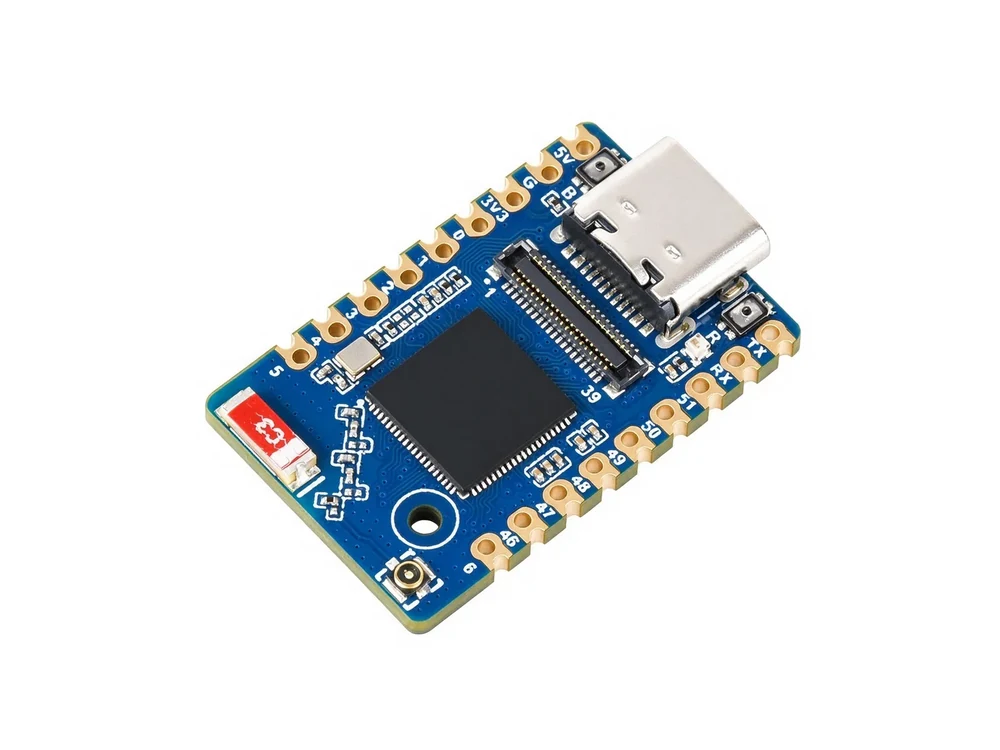

  <h1>ESP32-S31-Zero</h1>
  
<strong>Compact ESP32-S31 wireless development board</strong>

  
<strong>English</strong> | <a href="README_ZH.md">简体中文</a>

  

    
    
    
  

  

    <a href="https://docs.waveshare.net/ESP32-S31-Zero/">🌐 Product</a> &middot;
    <a href="https://github.com/waveshareteam/ESP32-S31-Zero/releases/latest">📦 Firmware</a> &middot;
    <a href="examples/esp-idf/">🧩 ESP-IDF</a> &middot;
    <a href="hardware/">📚 Documentation</a>
  

  

---

## ✨ Overview

ESP32-S31-Zero is a compact ESP32-S31 wireless development board with USB Type-C, an RGB LED, BOOT/RESET buttons, and GPIO/LCD/touch/SD expansion interfaces. This repository provides ESP-IDF examples, factory firmware, and hardware resources.

| Feature | Device / interface |
| --- | --- |
| MCU | ESP32-S31, dual-core RISC-V, up to 320 MHz |
| Memory | 16 / 32 MB Flash, 16 / 32 MB PSRAM; see below |
| Wireless | 2.4 GHz Wi-Fi 6, Bluetooth LE |
| RGB LED | WS2812B-1010 on GPIO60 |
| Buttons | BOOT (GPIO61, active low), RESET |
| USB | Type-C, USB Serial/JTAG on GPIO33/34 |
| Expansion | GPIO, RGB LCD, touch, SD interfaces |

Memory options are listed below; `-M` denotes the pin-header version. Flash and PSRAM capacities are in MB.

| SKU | Model | Flash | PSRAM |
| --- | --- | ---: | ---: |
| 35879 | ESP32-S31-Zero-N16R16 | 16 | 16 |
| 36165 | ESP32-S31-Zero-N16R16-M | 16 | 16 |
| 35880 | ESP32-S31-Zero-N32R16 | 32 | 16 |
| 36166 | ESP32-S31-Zero-N32R16-M | 32 | 16 |
| 35121 | ESP32-S31-Zero-N16R32 | 16 | 32 |
| 36167 | ESP32-S31-Zero-N16R32-M | 16 | 32 |
| 35763 | ESP32-S31-Zero-N32R32 | 32 | 32 |
| 36168 | ESP32-S31-Zero-N32R32-M | 32 | 32 |

## 📦 Quick Start

For prebuilt examples, check [Releases](https://github.com/waveshareteam/ESP32-S31-Zero/releases) for the required `*-combined.zip`; source build instructions are in each example README.

1. Download the `*-combined.zip` for the example and framework version you need.
2. Extract it and run `python -m pip install esptool` in Ubuntu Bash or Windows PowerShell.
3. Connect the board with a USB data cable.
4. Replace `<PORT>` with the board port; run `.\flash_combined.bat "<PORT>"` in Windows PowerShell or `./flash_combined.sh "<PORT>"` in Ubuntu Bash.
5. Press RESET if the board does not restart automatically.

Restore the factory demo: download `ESP32-S31-Zero_FactoryOnly_20261020.bin` from [`firmware`](firmware/) and follow the [flashing instructions](firmware/README.md).

## 🧪 Examples

### ESP-IDF

| Example | Main feature |
| --- | --- |
| [01_gpio_output](examples/esp-idf/01_gpio_output/) | Drive 15 GPIOs high |
| [02_blink_rgb](examples/esp-idf/02_blink_rgb/) | Onboard RGB LED color cycle |
| [03_chip_info](examples/esp-idf/03_chip_info/) | Chip and Flash information |
| [04_boot_button](examples/esp-idf/04_boot_button/) | BOOT button input |
| [05_uart_loopback](examples/esp-idf/05_uart_loopback/) | UART loopback with a jumper |
| [06_i2c_scan](examples/esp-idf/06_i2c_scan/) | External I²C device scan |
| [07_wifi_scan](examples/esp-idf/07_wifi_scan/) | Nearby Wi-Fi networks |
| [08_wifi_sta](examples/esp-idf/08_wifi_sta/) | Connect to a Wi-Fi network |
| [09_wifi_ap](examples/esp-idf/09_wifi_ap/) | Create a Wi-Fi access point |
| [10_ble_advertiser](examples/esp-idf/10_ble_advertiser/) | BLE advertising and connection |
| [11_board_test](examples/esp-idf/11_board_test/) | LCD/touch/SD fixture test |
| [12_wifi_performance](examples/esp-idf/12_wifi_performance/) | Wi-Fi throughput console |

## 🛠️ Development Environment

| Framework | Configured version | Examples |
| --- | --- | ---: |
| ESP-IDF | `v6.1` (ESP32-S31 preview target) | 12 |

Example [11](examples/esp-idf/11_board_test/) requires ESP-IDF ≥6.2.0, and [12](examples/esp-idf/12_wifi_performance/) uses 6.2 development APIs; compatibility with the version above is not established for these two examples. Read their requirements before building.

## 📚 Resources

- [Schematic](hardware/schematic/)
- [Footprint](hardware/footprint/)
- [Product documentation and Wiki (Chinese)](https://docs.waveshare.net/ESP32-S31-Zero/)

## 🤝 Support

- Example or repository problem: [open an issue](https://github.com/waveshareteam/ESP32-S31-Zero/issues/new/choose).
- Product usage, hardware or order questions: [Waveshare support](https://service.waveshare.com/).

## 📄 License

Apache License 2.0. See [LICENSE](LICENSE).
