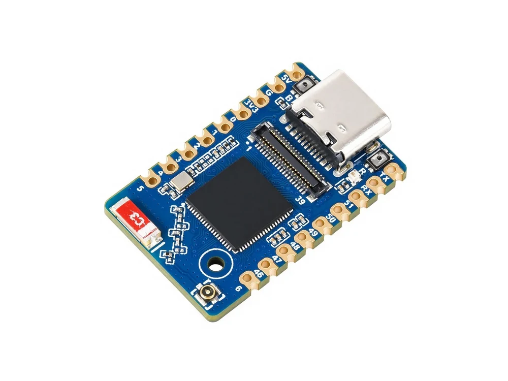

# Waveshare ESP32-S31-Zero

[English](README.md)

ESP32-S31-Zero V1.0 是基于 ESP32-S31 的小型开发板。所提供原理图包含 WS2812B-1010 RGB LED、BOOT/RESET 按键、USB Type-C、外置 SPI Flash、射频连接器，以及 GPIO/LCD/触摸/SD 扩展接口。扩展接口不代表板上已安装屏幕或触摸器件。

- [硬件证据与待确认项](docs/hardware.md)
- [示例清单与构建入口](docs/examples.md)
- [框架和依赖版本](docs/versions.md)
- [固件下载与烧录](releases/README.md)




## 产品概览

仓库保留 12 个原有 ESP-IDF 源码工程、测试二进制、原理图和封装文件。暂不使用其他产品图片。原理图标注 Flash 为 GD25Q256EYIGR（32 MiB），现有工程保留 16 MiB 镜像头与分区设置。PSRAM 容量和芯片完整订货后缀待确认。RGB 使用 GPIO60，低有效按键使用 GPIO61；Type-C 的 USB Serial/JTAG 使用 GPIO33/34，与原有外接 LCD 夹具共用。

## 框架支持

**实验 CI 已覆盖全部 12 个工程：ESP-IDF `6.2.0-dev-08e0d30a74ad`，固定提交 `08e0d30a74ad0bfd5a34933142b80f45619ee410`。** 本次已明确授权使用该开发版及 ESP32-S31 预览目标配置 CI。查到的最新 6.x 稳定版为官方 v6.1，但其中 S31 仍为预览目标；v5.5.6 没有该目标，未发现正式 v6.2 标签。版本及实验标记见[集中配置](config/frameworks.json)。矩阵已配置不代表实际编译通过；本阶段未执行完整固件编译或实机测试。本仓库没有 Arduino 工程。

## 示例

| ESP-IDF 工程 | 功能 |
| --- | --- |
| [01_gpio_output](examples/esp-idf/01_gpio_output/) | GPIO 输出高电平演示 |
| [02_blink_rgb](examples/esp-idf/02_blink_rgb/) | 板载 RGB LED |
| [03_chip_info](examples/esp-idf/03_chip_info/) | 芯片与物理 Flash 信息 |
| [04_boot_button](examples/esp-idf/04_boot_button/) | 低有效 BOOT 按键 |
| [05_uart_loopback](examples/esp-idf/05_uart_loopback/) | 外接跳线 UART 回环 |
| [06_i2c_scan](examples/esp-idf/06_i2c_scan/) | 扩展 I²C 总线扫描 |
| [07_wifi_scan](examples/esp-idf/07_wifi_scan/) | Wi-Fi 扫描 |
| [08_wifi_sta](examples/esp-idf/08_wifi_sta/) | Wi-Fi STA |
| [09_wifi_ap](examples/esp-idf/09_wifi_ap/) | Wi-Fi SoftAP |
| [10_ble_advertiser](examples/esp-idf/10_ble_advertiser/) | BLE 广播 |
| [11_board_test](examples/esp-idf/11_board_test/) | 保留的外接夹具综合测试 |
| [12_wifi_performance](examples/esp-idf/12_wifi_performance/) | 保留的 Wi-Fi 吞吐控制台 |

原有 12 个、新建 0 个、整理后维护 12 个工程。路径映射及所需设备见[盘点文档](docs/examples.md)。11、12 是保留的现有应用，并非本次新增综合功能。11 需要外接夹具，PSRAM、屏幕和触摸参数仍有待确认项。

## 使用入口

Ubuntu Bash，无固件编译：

```bash
python3 scripts/discover_examples.py all
python3 scripts/validate_repo.py
python3 -m unittest discover -s tests -v
```

Windows PowerShell：

```powershell
py -3 scripts/discover_examples.py all
py -3 scripts/validate_repo.py
py -3 -m unittest discover -s tests -v
```

使用[构建入口](docs/examples.md)及已批准的固定框架版本。成功构建会生成包含原始分段、紧凑合并镜像、清单、实际依赖锁、校验和及 Linux/Windows 烧录助手的 ZIP。[独立下载脚本](scripts/download_firmware.py) 可列出、选择、校验并安全解压公开 Release 固件，不自动烧录；实际 GitHub 发布仓库由维护者配置。已有[工厂测试镜像](firmware/README.md)单独保留，来源和烧录元数据尚不完整。

## 目录结构

| 路径 | 内容 |
| --- | --- |
| `examples/esp-idf/` | 12 个第一方源码工程 |
| `hardware/` | 原理图及封装文件 |
| `config/` | 硬件记录、框架版本及支持门槛 |
| `docs/` | 硬件、示例、依赖、CI 和验证说明 |
| `scripts/` | 发现器、构建入口、检查和独立下载工具 |
| `tests/` | 主机端工具回归测试 |
| `releases/` | 打包、完整集合校验和发布工具 |
| `firmware/` | 原有测试二进制，不进入源码构建矩阵 |
| `.github/workflows/` | 静态检查及带门槛的固件/发布流水线 |

## 验证与许可

[验证报告](docs/validation.md)分别说明静态测试、依赖解析、编译和实机验证。仅文档修改不触发完整固件构建。正式版本标签必须等待全部构建和包验证成功才可发布；不会覆盖公开版本，详见 [CI 说明](docs/ci.md)。

保留原有 Apache-2.0 [LICENSE](LICENSE)。第三方组件遵守其各自许可；不据此推定硬件设计文件和工厂二进制的独立授权范围。
